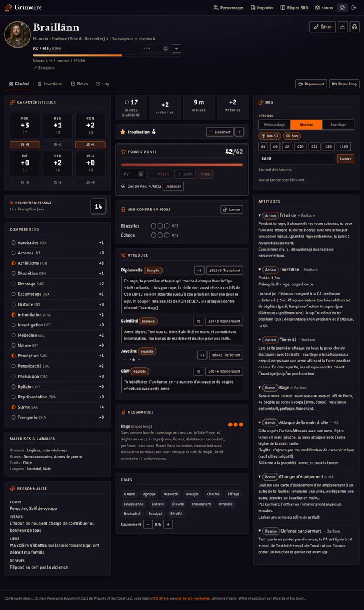

# Grimoire — fiches de personnage D&D 5.2

Petite application web auto-hébergée pour gérer des fiches de personnage *Donjons & Dragons* (règles 2024 / SRD 5.2.1), en français.

<p align="center">
  
</p>

## Essayer avec un personnage d'exemple

Le fichier [`examples/tharn-barbare.json`](examples/tharn-barbare.json) contient une fiche complète (barbare berserker de niveau 4 : attaques avec bottes d'arme, rage, aptitudes, inventaire avec contenant, monnaie, alliés et notes). Après avoir créé votre compte, ouvrez **Importer** et choisissez ce fichier.

## Fonctionnalités

- **Comptes** : identifiant et mot de passe (argon2), case « Rester connecté » (cookie de 30 jours, renouvelé à l'usage). Le premier compte créé est administrateur ; `ALLOW_REGISTRATION=false` ferme les inscriptions.
- **Fiche complète** :
  - identité, multiclasse, caractéristiques et sauvegardes, 18 compétences (maîtrise ou expertise) ;
  - CA, initiative, vitesse, PV et PV temporaires, dés de vie, états, épuisement 2024, Inspiration héroïque ;
  - résistances, immunités et vulnérabilités, sens spéciaux, Perception, Perspicacité et Investigation passives ;
  - attaques avec bottes d'arme, sorts (dont concentration) et emplacements, ressources de classe ;
  - aptitudes, dons (origine, généraux…), historiques 2024 (don d'origine, compétences et outil en un clic) ;
  - maîtrises, inventaire, objets harmonisés (3 au maximum) et monnaie, personnalité, alliés, notes, liste « à vérifier ».
  - Les valeurs dérivées sont calculées automatiquement et peuvent être forcées.
- **Vue Édition** : accès à tous les champs, avec enregistrement automatique.
- **Vue Jeu** :
  - clic pour lancer les tests, sauvegardes, compétences, l'initiative, les attaques puis les dégâts ;
  - avantage ou désavantage, critiques (dés doublés), pénalité d'épuisement, jets contre la mort ;
  - dégâts typés (résistance = moitié, vulnérabilité = double, immunité), soins et PV temporaires, dés de vie, emplacements, ressources, repos court et repos long ;
  - **effets activables** (Rage, Témérité…) : un clic dépense la ressource liée et applique bonus de dégâts, CA, avantage et résistances jusqu'au repos ;
  - **concentration** : sort en cours, JdS de Constitution proposé avec son DD après des dégâts ;
  - bouton **Annuler** (et Ctrl+Z) pour revenir sur un clic de trop ;
  - inventaire, monnaie et notes modifiables ;
  - plateau de dés libre et journal des lancers.
- **Import et export JSON** : format natif versionné, plus import du format libre en français avec avertissements sur les incohérences.
- **Images** : upload HEIC (iPhone), JPEG, PNG ou WebP, converties automatiquement en JPEG.
  - Galerie par personnage, portrait, zoom.
  - **OCR local Tesseract** (fra et eng) avec redressement automatique des photos inclinées (plusieurs angles testés).
  - Suggestions de valeurs de fiche à valider, et lecture de **cartes** (objet, aptitude) : titre, description et usage (« 1 / repos long ») ajoutables en objet, aptitude ou ressource.
- **Référence SRD 5.2.1 en français** (et en anglais, au choix) : sorts, armes, armures, équipement, objets magiques, dons, glossaire. Recherche et ajout direct à une fiche.
- **Dés 3D** (three.js et cannon.js) façon Baldur's Gate 3 : les dés roulent à l'écran avant l'affichage du résultat. Désactivables, avec ou sans son.
- **Hors ligne** : l'application et les fiches déjà ouvertes restent consultables sans réseau. Les modifications sont gardées sur l'appareil et envoyées au retour de la connexion (en cas de modification entre-temps sur le serveur, la fiche propose de recharger ou d'écraser).
- Interface inspirée de Foundry VTT : thème sombre par défaut (Signika et Amiri, accent orange) et thème clair « parchemin ». Mise en page mobile, impression, installable sur l'écran d'accueil iPhone.

## Maître du Donjon et journal

- **Maître du Donjon** : dans Édition › Partage (MJ), le propriétaire d'une fiche désigne un ou plusieurs comptes MJ par leur identifiant. Le MJ voit la fiche dans « Partagés avec moi », peut tout modifier (y compris via son accès MCP), mais ne peut ni la supprimer ni gérer les partages. Il peut se retirer lui-même.
- **Table du MJ** (`/table`, depuis « Partagés avec moi ») : toutes les fiches partagées sur une page, actualisée toutes les 15 secondes : PV, CA, initiative, valeurs passives, DD des sorts, états, effets actifs, concentration, résistances.
- **Journal (onglet Log)** : chaque modification est inscrite avec son auteur, son rôle (propriétaire ou MJ), son origine (web ou IA/MCP) et le détail avant → après. Les enregistrements automatiques successifs d'une même personne sont regroupés sur 2 minutes.

## Accès IA (MCP)

Grimoire expose un serveur [MCP](https://modelcontextprotocol.io) minimaliste sur `POST /mcp` (transport « Streamable HTTP », réponses JSON, sans session). Un assistant IA peut ainsi manipuler les fiches **d'un utilisateur** :

1. Dans **Mon compte › Accès IA (MCP)**, créez un jeton personnel (`grm_…`). Il n'est affiché qu'une fois et reste révocable.
2. Déclarez le serveur dans votre client MCP. Par exemple avec Claude Code :

```bash
claude mcp add --transport http grimoire https://votre-domaine/mcp --header "Authorization: Bearer grm_…"
```

Le jeton ne donne accès qu'aux fiches de son propriétaire. Outils disponibles :

| Outil | Rôle |
| --- | --- |
| `list_characters`, `get_character` | Lister les fiches, lire une fiche avec toutes les valeurs calculées (option `raw` pour le JSON complet) |
| `create_character`, `update_character` | Créer une fiche, appliquer un patch JSON partiel (validé par le schéma) |
| `roll_dice`, `roll_check` | Lancer une expression, ou un jet de la fiche (caractéristique, sauvegarde, compétence, initiative, attaque + dégâts, contre la mort) ; enregistré dans le journal |
| `adjust_hp` | Dégâts (typés : résistances appliquées, DD de concentration indiqué), soins, PV temporaires |
| `manage_inventory` | Ajouter/retirer des objets (avec contenant), gérer la monnaie |
| `use_resource` | Ressources de classe, emplacements de sorts, Inspiration |
| `rest` | Repos court / long |
| `search_rules` | Recherche dans le SRD 5.2.1 (fr/en) |

Si une fiche est ouverte dans le navigateur pendant qu'une IA la modifie, l'interface signale la modification et propose de recharger.

## Lancer avec Docker

```bash
git clone https://github.com/nithou/grimoire.git
cd grimoire
cp .env.example .env   # optionnel
docker compose up -d --build
```

Ouvrez ensuite http://localhost:8080 et créez le premier compte. Les données (SQLite et images) sont stockées dans `./data`.

Pour sauvegarder la base :

```bash
docker compose exec grimoire node dist/backup.js
```

La copie est écrite dans `data/backups/`.

Derrière un reverse proxy HTTPS, définissez `COOKIE_SECURE=true` et `TRUST_PROXY=true`.

## Développement

```bash
npm install
npm run build:srd        # génère srd/index.json
npm run dev:server       # API sur :8080 (OCR : brew install tesseract tesseract-lang)
npm run dev:client       # Vite sur :5173 (proxy /api)
npm test                 # tests unitaires (règles, dés, import, OCR, index SRD)
npm run typecheck
```

## Structure

- `src/shared` : schéma de fiche (zod), règles 5.2, dés, listes FR, import JSON, analyse OCR (code partagé entre client et serveur).
- `src/server` : Fastify, SQLite, sessions, uploads, OCR, index SRD.
- `src/client` : React et Vite.
- `srd/` : markdown du SRD 5.2.1 anglais vendorisé depuis [downfallx/dnd-5e-srd-markdown](https://github.com/downfallx/dnd-5e-srd-markdown).
- `srd/fr/srd-fr.md` : SRD 5.2.1 français converti depuis le PDF officiel. Pour le régénérer :

```bash
node scripts/srd-pdf-to-md.mjs ressources/FR_SRD_CC_v5.2.1.pdf srd/fr/srd-fr.md
```

- `src/client/public/dice/` : librairie de dés 3D [sarahRosannaBusch/dice](https://github.com/sarahRosannaBusch/dice) (MIT), légèrement adaptée (voir `SOURCE.txt`).

## Licence du contenu

Ce projet contient du contenu du *System Reference Document 5.2.1* de Wizards of the Coast LLC, sous licence [CC BY 4.0](https://creativecommons.org/licenses/by/4.0/). Grimoire n'est ni affilié ni approuvé par Wizards of the Coast.
